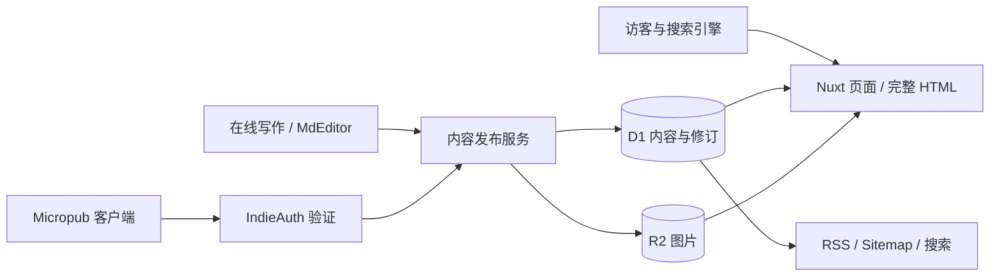

# 博客技术架构与 SEO 规划

## 当前结论

推荐 **Nuxt + Cloudflare Workers + D1 + R2**。沿用现有 Cloudflare 部署经验，公开页面使用完整 HTML，固定页面按需预生成，写作和 Micropub 使用动态服务。

这是正式站的实施方案，尚未部署。当前 Vue / Vite 设计稿继续用于评审界面；它的 hash 路由和客户端渲染不能直接作为正式博客的 SEO 实现。

## SSG 的取舍

SSG 能做：构建时读取内容，生成每篇文章的 HTML。在线写作和 Micropub 则仍需要数据库、认证、上传和发布接口。全站 SSG 的发布链路是“保存内容 → 构建 → 部署 → 新地址可读”，必须处理构建失败、并发发布和等待状态。

这个博客需要经常在线写短记、修改文章，因此首版采用混合渲染：固定内容预生成，变化的内容服务端渲染。正文同样直接存在于 HTML 中，而且发布无需触发整站构建。Nuxt 支持按路由选择渲染方式；保留动态服务应使用服务端构建，纯 `nuxt generate` 产物不包含服务端接口。[Nuxt 渲染模式](https://nuxt.com/docs/4.x/guide/concepts/rendering)

| 方案 | 适合的发布方式 | 主要代价 | 本项目选择 |
| --- | --- | --- | --- |
| Pages 全站 SSG + 独立写入服务 | 写完后可以等待构建 | 需要维护发布队列、构建结果与内容状态的一致性 | 可行的备选 |
| Workers 上的 Nuxt 混合渲染 | 在线写作、即时发布和修改 | 需要验证运行时兼容性、数据库访问和缓存规则 | 推荐 |
| 自管服务器运行 Nuxt | 已有稳定服务器与维护习惯 | 需要自己管理运行环境、监控和备份 | 当前不优先 |

SSR、SSG 都可以提供可抓取的 HTML。选择依据是更新方式与运维成本；搜索排名还取决于内容和实际体验。Google 建议服务端渲染或预渲染，也明确指出并非所有爬虫都能执行 JavaScript。[JavaScript SEO](https://developers.google.com/search/docs/crawling-indexing/javascript/javascript-seo-basics)

## 技术组成

| 层次 | 选择 | 职责 |
| --- | --- | --- |
| 应用 | Nuxt、Vue、TypeScript、pnpm | 正式路由、页面 HTML、元信息、服务端接口 |
| 视觉与阅读 | QuireKit Design、`QuireMarkdown` | 复用当前设计，输出语义正文 |
| 写作 | `MdEditor`，仅写作页加载 | Markdown 编辑、上传、预览、云端草稿 |
| 运行与静态资源 | Cloudflare Workers + Static Assets | 运行 Nuxt / Nitro，分发构建资源 |
| 内容数据库 | Cloudflare D1 | 内容、修订、标签、项目、媒体元信息与发布状态 |
| 媒体 | Cloudflare R2 | 原图及派生图片；公开素材与草稿素材分开授权 |
| 身份 | 单作者后台登录 + IndieAuth 兼容认证 | 网页会话和第三方 Micropub 令牌各自验证 |
| 搜索与订阅 | 应用内查询、RSS / Atom | 首版按标题、摘要和标签检索；中文全文检索另行验证 |

Cloudflare 提供 Nuxt 部署到 Workers 的官方路径；D1 提供 SQLite 语义的托管数据库，R2 提供对象存储。[Nuxt on Workers](https://developers.cloudflare.com/workers/framework-guides/web-apps/more-web-frameworks/nuxt/)、[D1](https://developers.cloudflare.com/d1/)、[R2](https://developers.cloudflare.com/r2/)

首版只维护一个博客应用，不先拆微服务，不引入独立搜索集群。数据库访问、对象存储和认证各有适配层，领域逻辑不依赖部署供应商。域名、实际套餐与图片处理服务在上线前结合实测选择；费用评估包括请求与 CPU、数据库读写、存储和图片处理，不预先承诺永久免费。

## 路由与渲染

| 路径 | 渲染与索引策略 |
| --- | --- |
| `/` | SSR，展示最新文章、项目与生活记录，允许索引 |
| `/articles`、`/articles/page/:page` | SSR，提供普通分页链接，每页自引用 canonical |
| `/articles/:slug` | SSR 完整正文；稳定 URL，允许索引 |
| `/life`、`/life/:id` | SSR；短记和照片各有永久地址；详情按内容质量决定是否索引 |
| `/projects`、`/projects/:slug` | 首版随代码维护时可预生成；接入在线修改后改为 SSR |
| `/about` | 预生成，允许索引；内容随部署更新 |
| `/tags/:slug` | 有明确主题、有效内容时索引，空页和临时筛选不进入 sitemap |
| `/search` | 可交互搜索，`noindex`，不进入 sitemap |
| `/write`、草稿与私密预览 | 登录保护，编辑器仅在客户端挂载，`noindex`、`private, no-store` |
| `/api/micropub`、媒体与写作接口 | 动态处理，按身份和操作授权，不做共享缓存 |
| `/sitemap.xml`、`/feed.xml`、`/robots.txt` | 服务端输出；站点地图与订阅只包含当前公开内容 |

公开正文不可整体放进 `ClientOnly`，也不能用 Canvas 或挂载编辑器代替可索引的 HTML。文章标题由页面持有，正文从合适的小节层级开始；目录锚点稳定且唯一。图片、公式、图表和嵌入内容需要可读的服务端结果或文本替代。

## 内容与发布

内容模型至少包含稳定 ID、类型、slug、状态、作者、来源格式、源内容、公开修订、创建 / 首次发布时间 / 实质修改时间、摘要、标签和媒体引用。文章、短记共用发布规则，项目保存专门的展示信息；slug 不随标题自动改变。

保存来源格式：站内 Markdown、外部纯文本、外部 HTML 分别处理。Micropub 属性保留数组和未知属性；未支持的呈现能力明确反馈，不能往返编辑后静默丢失。HTML、链接与嵌入内容在服务端按允许范围处理，不能仅信任编辑器的前端校验。

网页写作与 Micropub 共用发布服务：

1. 验证身份、操作权限、内容和媒体引用，构造待发布修订。
2. 验证正文可渲染，并生成一致的摘要、目录和 SEO 数据。
3. 原子写入修订、公开版本指针与需要重试的发布后任务；失败时保留已有公开版本与草稿。
4. 正式地址可读取新公开版本后，返回发布成功与永久 URL。
5. 后续任务按内容版本幂等执行；后台展示失败与重试状态，不因订阅或缓存任务重试而重复创建文章。

首版同步完成核心发布，Micropub 创建成功返回 `201` 与 `Location`。若未来采用异步构建，按协议使用 `202` 与 `Location`，先完成请求校验，并提供明确的待发布状态。[Micropub 创建响应](https://www.w3.org/TR/micropub/#response)

草稿自动保存与手动发布分开：界面区分“本机备份”“云端已保存”“已发布”。保存请求带修订标识，多设备编辑冲突时保留两份内容。预览读取指定草稿修订，不进入公开数据查询或 Nuxt 公共 payload；私密素材不能因知道 URL 就被读取。

## 缓存与更新边界

首版先让动态 HTML、公开内容数据接口及 payload 读取当前公开版本，关闭这些响应的共享缓存；带内容指纹的脚本、样式和公开图片可以长缓存。这样先验证发布、修改、删除、恢复的正确性，避免低流量个人站过早承担缓存失效复杂度。

需要优化时，再加入按版本缓存的正文片段或页面。文章缓存键包含公开修订与渲染版本；首页、列表、标签、分页、feed 和 sitemap 依赖站点发布版本。读取公开状态与最新版本后才命中缓存，撤回不能继续返回旧正文。浏览器内的数据缓存、Nuxt payload 与服务端缓存必须同步处理。

如果启用按 URL 的 CDN 整页缓存，必须补齐跨节点失效与撤回验收；不能把一次 `cache.delete()` 当成全网删除。Cloudflare Cache API 的存储与删除有数据中心范围，且不直接支持 `stale-while-revalidate`。Nuxt 的平台 ISR 配置也不能直接等同于 Cloudflare 全局缓存。[Cloudflare Cache API](https://developers.cloudflare.com/workers/runtime-apis/cache/)、[Nuxt 路由规则](https://nuxt.com/docs/4.x/guide/concepts/rendering#route-rules)

缓存优化是后续性能措施，不改变发布成功、撤回与私密内容的可见性规则。

## Micropub 首版范围

实现 endpoint 发现、表单 / JSON 创建文章与短记、照片与媒体 endpoint、配置和来源查询，以及更新、删除、恢复。更新正确处理 `replace`、`add`、`delete`，返回状态与永久地址遵循协议；草稿、定时发布、跨平台同步按扩展能力独立声明。[W3C Micropub](https://www.w3.org/TR/micropub/)

认证优先接入符合 IndieAuth 的服务并验证互通；校验站点身份、令牌有效性与操作 scope。普通后台登录不能代替 Micropub 认证。网页入口使用安全会话和 CSRF 防护，浏览器不保存服务端管理凭证。以协议请求用例与至少一个真实第三方客户端验收，不能仅凭本站编辑器成功发布就宣称兼容。[IndieAuth](https://indieauth.spec.indieweb.org/)

## SEO 上线要求

| 项目 | 必须满足的行为 |
| --- | --- |
| 首个 HTML | 含标题、正文、作者、时间、导航和内链；关闭 JavaScript 仍可阅读和翻页 |
| 正式地址 | 使用 `/articles/slug` 等真实路径；直接请求和刷新都可用；不用 `#/...` 区分内容 |
| 状态码 | 公开页面为 200；不存在为 404；删除按规则返回 404 / 410；旧地址用永久重定向，不能全部回首页或返回 200 空壳 |
| 规范化 | 统一 HTTPS、主域名和尾斜杠规则；canonical、内链、分享地址与 sitemap 保持一致；追踪参数不产生重复内容 |
| 元信息 | 各页有准确的 title、description、canonical、Open Graph 和分享图；服务端输出，标题改动与正文同一版本 |
| 结构化数据 | 长文采用 BlogPosting，填写真实作者主页、标题、日期与适用图片；日期带时区，修改日期只反映真实修改 |
| 内容结构 | 使用语义标题、段落、链接、列表、表格和代码；照片有描述；作者页、项目与文章之间形成自然内链 |
| 收录边界 | 草稿、预览、搜索、重复筛选不进索引；公开分类和短记按内容质量决定，不制造大量空标签页 |
| Sitemap | 仅包含可索引的公开 canonical URL；新增、改址、删除同步更新，`lastmod` 使用真实内容更新时间 |
| Robots | 允许公开页面与必要资源被抓取；需识别 `noindex` 的公开页面不能同时被 robots 阻止抓取；私密内容仍须身份验证 |
| 分享与订阅 | 分享卡片可抓取；RSS / Atom 输出当前公开版本，不包含草稿；每项有稳定 ID 与永久地址 |

规范地址采用一致的重定向与 canonical 信号；结构化数据帮助搜索引擎理解文章，但不保证特殊搜索展示。sitemap 的更新时间也不能直接用每次部署时间代替。[Canonical](https://developers.google.com/search/docs/crawling-indexing/consolidate-duplicate-urls)、[文章结构化数据](https://developers.google.com/search/docs/appearance/structured-data/article)、[Sitemap](https://developers.google.com/search/docs/crawling-indexing/sitemaps/build-sitemap)

SEO 设置放在写作页的折叠区：默认从标题、摘要、封面推导，允许作者覆盖描述和分享图；首次发布后保留 slug，改址时提示创建重定向。继续采用紧凑写作顶部，不为这些设置增加大块首屏区域。

## 性能、运维与恢复

阅读页不下载 `MdEditor` / CodeMirror。语法高亮、公式和图表增强按内容需要加载，基础文本不依赖这些脚本才出现。使用图片尺寸占位、响应式尺寸与现代格式；首屏主要图片不延迟加载，非首屏图片按需加载。字体优先使用当前系统字体方案。

上线后的真实用户目标：手机和桌面分别按第 75 百分位衡量，LCP ≤ 2.5 秒、INP ≤ 200 毫秒、CLS ≤ 0.1。上线前用慢网、较弱设备与生产构建做实验室检查；Lighthouse 分数不能代替真实用户指标或排名结果。[Core Web Vitals](https://web.dev/articles/vitals)

Workers 验证要测构建包大小、启动与渲染耗时、内存和绑定访问，不能只看本地 Node 成功。按目标读者网络实测国内与海外访问，公开页面不出现爬虫无法通过的登录或交互挑战。若运行环境不适合，保留 Nuxt 标准服务端部署退路，不修改依赖产物来绕过限制。

开发、预览和生产使用不同数据库、存储与凭证。预览环境限制访问并禁止索引。对数据库和媒体做可导出的备份，验证恢复后正文、永久链接和媒体引用一致；部署回滚不应覆盖新文章。记录发布失败、渲染错误、404、数据库错误和用量，日志不记录令牌或私密草稿正文。

## 实施与验收顺序

| 阶段 | 交付与通过条件 |
| --- | --- |
| 阅读链路验证 | Nuxt 真实路径；QuireKit 在生产构建和 Workers 运行时可生成完整 HTML；覆盖长文、代码、表格、图片、公式；水合无正文丢失或错位 |
| 正式阅读站 | 数据模型与迁移、文章 / 生活 / 项目页；title、canonical、结构化数据、RSS、sitemap、正确状态码；无脚本阅读、内链与分页检查通过 |
| 写作发布闭环 | 登录、云端草稿、上传、预览、发布和修订；失败不丢内容；新建、修改、改址、删除、恢复后页面与订阅一致 |
| Micropub 互通 | 协议请求矩阵和真实客户端通过；确认权限、媒体、来源格式及更新语义 |
| 上线检查 | 域名规范化、生产密钥、备份恢复、目标网络性能；Search Console 验证、提交 sitemap、检查代表性 URL；按目标受众接入其他搜索平台 |

完成这些工程验收后才称为具备上线 SEO 基础。是否收录、何时收录与排名由搜索引擎决定，后续通过 Search Console 和实际访问数据持续检查。

## 已验证与尚待验证

- 已验证 `@quirekit/incremark@0.0.1-alpha.1` 的 `QuireMarkdown`：Node 22 + Vite SSR，在没有 `window` / `document` 的环境中输出标题、段落、真实链接、代码和表格 HTML。
- 可用 `pnpm verify:reader-ssr` 重现。它验证阅读组件的服务端输出能力；并未把当前设计稿改成 SSR / SSG 网站。
- 尚待验证 Nuxt / Nitro 生产构建、Workers 的实际运行限制、完整页面元信息、水合、HTML 安全处理、复杂内容、数据库发布和真实 Micropub 互通。
- 当前网站仍是设计预览，正式域名、个人素材和线上内容尚未接入。
